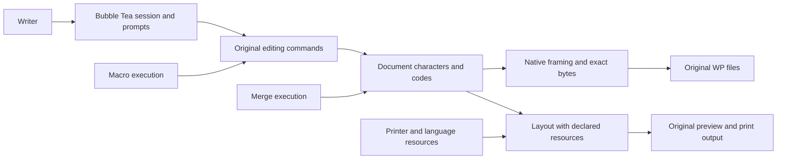

# Implementation plan: WordPerfect 5.1 parity

Branch: `feat/wp51-parity`. Date: 2026-10-30. Authority: [spec](spec.md), [research checkpoint](research.md), [domain model](data-model.md).

## Delivery strategy

M1 remains complete WP 5.1 DOS parity. Start with a bounded native preservation milestone while research closes the rest of the catalogue. This plan is an architecture and sequencing baseline, not permission to guess undocumented semantics. The first task queue covers foundations and explicit investigations; subsequent implementation packages must be authored from their outputs before full M1 acceptance. Completing this queue alone cannot satisfy SC-001–005.

Use the pinned Go module and Bubble Tea version already in go.mod; Linux target. Do not update dependencies for scaffolding. Use Go testing and fuzzing for native boundaries, the existing Python reference runner for the original executable, and stable inventory/scenario IDs for differential checks. Native WP documents/companions are the only persistent product formats; diagnostic test manifests are project tooling, never required document sidecars.

## Context and component boundaries

Dependency direction is inward toward document semantics. No terminal dependency in native parsing, document editing or layout. Macro and merge execution keep distinct state machines despite shared token vocabulary. See `data-model.md` for invariants. Proposed packages are created only when their bounded work begins:

- `internal/wp51`: exact byte image, validated native framing, original character/code identity and preservation. No filesystem replacement or terminal code.
- `internal/document`: editable semantic positions, paired-code relationships and command-specific Undelete; mutations must declare supported structures.
- `internal/editor`: session, original commands/prompts/modes and both document screens. Uses document services; never edits serialized bytes independently.
- `internal/tui` and `cmd/wordling`: Bubble Tea rendering, input adaptation and application composition.
- `internal/storage`: safe native read/write transactions and original save decisions supplied by editor. Retains existing files on failure.
- `internal/layout`, `internal/resources`, `internal/printing`: original geometry/resource interpretation and output, independent of terminal wrapping.
- `internal/macro`, `internal/merge`: original companion decoding and execution, with explicit call/loop/handler and record/copy/page contexts.
- `testdata` and test-only fixture manifests: provenance-approved native fixtures selected from existing original runs. Reference binaries remain ignored and external.

No plugin framework, generalized workflow engine, Unicode-only canonical document, or rewritten document format is introduced. Public Go APIs are unnecessary initially; keep packages internal until real consumers justify stability guarantees.

## Native preservation contract and first milestone

First implement framing and no-edit pass-through only. An immutable owned byte image is authoritative. Validated spans retain native order and offsets; semantic decoding is additive. Expose parsing support explicitly: recognized, opaque-but-preserved, malformed/refused. Do not treat unknown data as empty content. A structurally framed file is not necessarily semantically editable.

The first reader contract must document SDK51 field offsets, integer widths/endian rules, checked arithmetic, packet/index traversal, cycle/truncation handling and prefix/body bounds before coding. WP01 selects fixtures and records this contract. Until validated, unsupported variants are refused with typed errors; they stay in the M1 backlog. Native no-edit export copies the exact owned image, including uninterpreted data and trailing bytes; it never reconstructs headers or timestamps. Source buffers and exported buffers cannot mutate internal state.

Safe filesystem replacement follows as a separate package. Candidate bytes and failure paths are tested before any original-app retrieval. No general edit writer is authorized by a pass-through test. Semantic writes require their own scenario contracts, byte preservation checks and original retrieval/edit/print/save acceptance.

## Research gates and full-scope continuation

| Workstream | Requirements | Output required before implementation |
| --- | --- | --- |
| Native framing and corpus | FR-002/003, NFR-001/003 | Documented field/framing contract, provenance fixture list, malformed cases and explicit parser budgets |
| Coverage and edition reconciliation | FR-001, all FRs | Every chapter/appendix/menu/utility and workbook step classified; remaining gaps retain stable IDs |
| File operations and Linux mappings | FR-006/007/017 | Original prompt/failure/conversion/locking/shell contracts; tested adaptation ADRs |
| Editor and formatting | FR-004/005/008 | Command state transitions and native effects, original observations for each slice |
| Layout and resources | FR-009/015/016, NFR-005 | Historical/resource profiles, metric units, exact page/print comparisons and justified tolerances |
| Structured content and graphics | FR-010/011 | Native structures, calculations/generation/graphics/equation behavior and interoperability fixtures |
| Automation and data | FR-012/013 | Context-specific macro/merge expressions/errors/loops and data/import/link contracts |
| Characters and language | FR-014, FC-006 | Original character identities, mapping/display limits and external resource strategy |

Research package completion yields reviewed contracts and follow-up implementation packages, not a verified feature label. Unknown behavior blocks only the affected slice. Every queue revision must preserve requirement links and show which scope is still unqueued; no final mission accept while any original obligation is unresolved.

## Verification strategy

- All changed Go: gofmt, `go build ./...`, `go test ./...`, `go vet ./...`. Reader packages require truncated/oversized/cyclic/framing-negative tests and a reproducible fuzz invocation with declared budgets. Set budgets in WP01 from format bounds and measured harness behavior; no unmeasured product performance claims.
- Accepted no-edit fixtures: compare bytes, length and SHA-256; test opaque span/trailing-byte preservation and caller buffer isolation. Self-generated fixtures supplement rather than replace original-produced fixtures.
- Filesystem safety: inject failures before write, during candidate creation and before replacement; verify original bytes and absence of false success. Concurrent source change and symlink/path policy are explicit contracts, not guessed Linux adaptations.
- Each supported semantic edit: original command transcript, same declared inputs/resources, native invariants plus original reopen/edit/print/save. Expect different unrelated timestamps only when the original scenario explicitly documents them; never normalize raw evidence.
- Existing catalogue checks: `python3 scripts/render-inventory.py --check` and `python3 scripts/render-scenarios.py --check`. Python changes additionally compile; original reference probes run only for new questions or changed harness behavior.
- Terminal interaction checks compare command/session state independently of visual snapshots. Original print-to-disk, preview and utilities remain M1; PDF stays M2.

## Risks and safeguards

Mixed manual editions and current FreeDOS/printer limitations remain declared. Expanding profiles is a research task, not a baseline replacement. Encryption, nested packets, alternate characters and resource dependencies may narrow which files are initially safely interpretable; unsupported inputs produce explicit refusal without modifying their source. Performance/size targets and full layout tolerances remain gated research outputs before those implementations. Proprietary manuals/resources never enter the public repository.

## Continuous local execution

Use `spec-kitty next --agent codex --mission wp51-parity-01M64CVY --json` to inspect; the issued action and its prompt own the next work. Report `--result success` only after that issued step's real artifacts and validation are complete. Preserve failures in traces, fix the specific cause and retry; never mark M1 done to escape an empty initial queue. Work packages are implemented and reviewed in dependency order. A review rejection returns to the package; unrelated research can continue without weakening its gate.

This is active-chat local execution, not a scheduled/background automation or a hosted-sync claim. Hosted auth/queue warnings are logged separately. Final integration targets GitHub main after actual acceptance; the existing mission placement target_branch remains feat/wp51-parity.

## Charter check

FC-001–010 preserved; two missions unchanged; Go/Bubble Tea retained; unknown bytes retained or unsafe edits refused; native readers/writers gated by appropriate tests; complete original scope stays visible. No new resource license, dependency, platform exclusion or governance policy selected. Architectural decision ADR 0002 records the byte-preservation boundary; later semantic storage/layout choices require evidence-backed ADRs.
