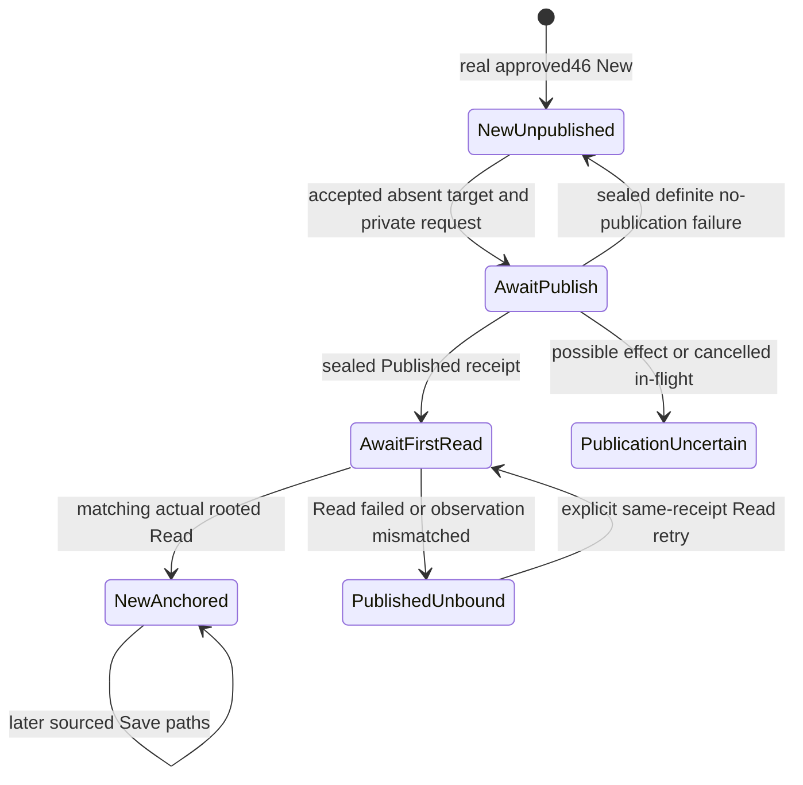

# N1: First source anchor without losing native New birth

Temporary architecture decision, requiring independent review before task authoring. Architect Alphonso/plan context and diagram guidance resolved. Own future N1 only internal/editor/**. No code, canonical task, primary, lifecycle or guest changes. Approved storage41 is consumed, not changed. Actual46 code/API remains pending; this decision does not authorize implementation against its design alone. Full actual44 fourteen-class original/control approval and46 implementation approval remain prerequisites. Full M1 remains open.

## Source authority and limits

The frozen next-workflow report identifies the concrete seam. Approved36 source b184049a223e346588641ebf4434cc9d88f4977e keeps private Session.transition/bufferID, actual history suspension on F10 and copied source/native/request wrappers. Existing native startup is nil and ordinary Read completion Parse creates Loaded. Those paths cannot stand in for native46 New. Approved41 source5ad84e4 plus0df934c supplies PrepareNewPublication/PublishNew; PublicationID only has Operation/Revision and is explicitly correlation, not authorization/cancellation/document identity. No field added below is attributed to41.

Actual41 Outcome contains State, Name, DirectoryID and Identity (ID Device/Inode, Size, Mode, Modified, Changed, SHA256). Actual rooted Read returns *storage.Document; Name(), DirectoryID(), Identity(), Export() are available. Directory wraps one private opened acquisition with shared Close. Copies of that wrapper share the same acquisition; a separately reopened same-path handle is a different authority even with equal DirectoryID. Actual41 preparation owns accepted bytes/target/capability, and PublishNew delegates unchanged transaction/absence/cleanup guards. Existing loaded publication and cross-directory synchronous Save semantics are unchanged.

Promoted E design39a400e3/schemafa2047 requires private native birth, fresh New revision even for equal bytes, lifetime New OriginalExport→NoLoadedOriginal and Loaded initial-image semantics. Its future exact public origin-selection/constructor seams must be inspected after46 approval. N1 must consume a closed typed constructor selection; it must not infer New from Source()==nil, hash, filename, framing acceptance or prefix size. If approved46 exposes no safe origin query/receipt needed for N1, report that exact API prerequisite for separate document-owner review; no reflection, duplicate origin model or public setter.

## Chosen model

Keep native birth and a separate private Session publication phase. The phase does not relabel native New as Loaded. No filesystem IO in New/configuration/Reduce, and no IO used to initialize a pure buffer. Native genesis bytes never become a fabricated storage.Document.

These are internal safety states, not newly claimed original prompts. `AwaitPublish` begins when the reducer queues the captured host request; actual41 PrepareNewPublication happens outside the reducer. A preparation object is not a saved file. Never-published means no accepted/possibly-effective publication has occurred for this birth, not merely “no source field.”

| Phase | Source guard | Current native | Clean / retry rule |
| --- | --- | --- | --- |
| NewUnpublished | absent | true New, retained genesis/current revision | Startup empty may be unmodified, but not saved/named; nonempty native is unsaved. Only this phase can request source-less publication. |
| AwaitPublish | absent | exact pending New revision retained | Waiting; no native mutation, second save, macro effect or clear while request outstanding. Filename cancel before submission is harmless; cancellation after submission is not proof of no effect. |
| AwaitFirstRead | absent; retain published receipt | same New | Not clean/exit-safe merely because publication succeeded. Do not republish. Queue actual Read at exact captured capability/name. |
| PublishedUnbound | absent; successful receipt retained | same New | Not clean, not a source-less retry. Permit only explicit same-receipt binding retry and non-mutating inspection/host shutdown preserving the unresolved receipt. No pretend save/exit success. |
| PublicationUncertain | absent; retain exact uncertain/error evidence | same New | No automatic retry, republish, guessed binding or clean. Reconciliation is a named later safety workflow; it cannot be invented by re-Observe or matching current bytes. |
| NewAnchored | actual first Read snapshot | still New | SavedRevision is the acknowledged published native revision; clean iff current native revision equals it and no unresolved effect exists. Later SaveAs does not rebase guard. |
| Loaded (existing) | original acquisition | existing Loaded | Existing36/27 code and guards unchanged. Never route through New publication. |

Startup unmodifiedness, named/saved state and native revision equality are distinct. Extend the private dirty/safety calculation so an unresolved publish/bind cannot compare as clean against a zero/unset saved revision. Expose truthful phase/unresolved receipt in Snapshot (bounded value), not an invented original dirty-bit interpretation. New genesis has a privately recorded genesis revision for unmodified startup; it is not a successful saved revision. F10 empty Save is supported by43 original evidence. Save completion names/saves only after first anchor acceptance; while bind is pending the intended name belongs to the publication receipt, not a committed successful Save. Host latency is an adaptation, not evidence of an original intermediate prompt.

## Typed request/completion contract (proposed editor API, not existing code)

Extend the existing IntentKind/Result event mechanism with distinct new-publication and first-binding kinds. Keep existing public inspection value conventions; append private proof/observation members rather than trusting public Kind/counters/Candidate/Outcome/Document as authority. This is the minimal new surface: two intent kinds, two out-of-reducer executor helpers analogous to approved ExecuteMacroRead, one opaque comparable accepted-request identity getter for host deduplication, and truthful Snapshot phase/first-publication receipt. No new storage API, public origin setter or alternate native codec. Exact names are provisional until46 source integration; semantics below are binding for review.

A private first-publication request captures: unique request token, accepted private Session transition and buffer identity, actual native New origin witness+Revision, monotonically issued operation/reducer revision, exact copied native candidate+hash/length, same opened Directory wrapper value, accepted absent Destination observation and resolved leaf/name. Public returns/getters are copies. Validate every public wrapper against captured values before IO, or use private values exclusively and refuse inconsistent wrappers; no public field may redirect execution. Comparing DirectoryID alone is insufficient: exact comparable storage.Directory value preserves actual acquired pointer authority; independently reopened equal-root handle must refuse, same-capability copy must work until any copy's legitimate Close. Concurrent caller mutation during an executor call is outside existing storage contract; post-acceptance wrapper reassignment is covered.

**Executor 1 (host adapter outside Reduce)** calls actual capturedDirectory.PrepareNewPublication(capturedTarget,capturedCandidate,storage.PublicationID{Operation,Revision}) then PublishNew(prepared,sameID). It captures a private immutable observation of phase reached, actual41 outcome/error/failure details, expected request token and privately owned accepted arguments. Do not expose prepared mutable request ownership to callers as a way to retarget IO. The public Result mirrors diagnostics; reducer validates the opaque observation, public equality and current exact pending token, not just matching counters/hash. Arbitrary public Outcome{Published,...} has no valid observation. Success accepts only actual Published, exact requested name/root, nonzero inode, matching candidate size/hash and no error. State Unchanged is invalid for source-less request. Outcomes/errors are captured before completion and not reconstructed from mutable diagnostic causes.

A definite failure before PublishNew invocation returns to NewUnpublished with no saved/name/anchor advance; cleanup residue and error stay visible. A PublishNew failure returns there only when the complete captured actual41 failure chain unambiguously establishes no publication and reports DestinationMayExist=false; an errors.Join tree with any possible-effect/unknown member is not reduced by accepting only the first errors.As match; fresh absent Observe and new operation are mandatory before another attempt. Never reuse old absence/prepared request, silently retry, overwrite residue or treat a foreign file at the name as ours. Any possible effect (typed DestinationMayExist=true), unrecognized publication error, inconsistent completion or lost/cancelled in-flight operation is unresolved. Existing41 does not return a “definitely absent forever” guarantee. Failure diagnostics/residue must survive; retry means user-requested new transaction after known no-publication, not hidden automatic execution.

On valid publish success, reducer stores the sealed receipt and captured revision/name/root and issues a distinct FirstBind read request. It does not yet update saved revision/source/displayed committed name or clear dirty/safety state. The private bind proof captures the accepted publication observation/token, original buffer+native origin, pending unique transition, exact captured capability/name and expected outcome identity. It contains no mutable public IO authority and no ability to substitute a different New instance with equal bytes.

**Executor 2 (host adapter outside Reduce)** uses exactly capturedDirectory.Read(capturedName). This actual acquisition is the only accepted storage source for this first bind. Record an opaque copied *storage.Document and exact Read error. Do not call ordinary Session Retrieve completion or document.Parse to replace live native. The reducer requires matching private bind token/current phase/buffer/New origin/native revision and an authentic observation produced by this executor. Then compare actual Document.Name/DirectoryID, Identity.ID (Device+Inode), Size, SHA256 against the successful publication receipt and candidate. Export must equal captured candidate bytes; size/hash alone do not replace the byte check. Inode reuse/hash identity does not prove external history; this is a bounded actual Read observation, not eternal file freshness.

Actual41 performs cleanup and then a final stable Read, specifically because removing its candidate hard link changes ctime; the returned Outcome.Identity describes that final observation. Require equality of the entire actual Identity value as a conservative first-bind safety check, including Mode/Modified/Changed, in addition to exact payload/inode/root/name. A metadata-only change can therefore refuse binding rather than be silently ignored. Retain actual rooted Read safety validation. The accepted current acquisition's entire identity becomes the guard for later checkSource; no freshness promise exists after the Read. Later external changes are caught only at actual later storage guard boundaries, as already approved.

Only after matching Read install a private copy of its storage.Document as first source anchor. Preserve the existing in-memory native pointer state/birth/Revision, cursor/view/selection/history fragments/receipts and all46 OriginalExport semantics. Set saved native revision to captured publication revision, committed display name to captured intended name and last publication receipt separately; keep origin/first anchor permanent. Never add a public source-rebase setter. Read success for another inode with identical bytes, independently opened same-path authority, wrong operation/buffer or different New birth is not binding. A loaded Source supplied by public Result is not enough.

## Retry, cancellation, Close and fork rules

Bounded single pending publication/bind and one retained first-publication receipt; no ancestry chain or global mutable history. Expose a small opaque comparable accepted-request key from the issued Intent, with private identity fields and zero invalid. It is inspection/correlation only, cannot mint an accepted request or choose IO authority, and does not expose native birth. Existing host IO deduplication must key this accepted-request identity, not counters alone where two immutable forks can share counters. Getters return the same key for copies of one issued request, distinct keys for separately accepted same-counter forks and bind retries. All existing loaded/macro request scheduling retains its approved semantics; use the new key only where this new first-save flow requires it. Executors are not advertised as general idempotent transactions: no-replace prevents a second successful publish at one name but does not make duplicate calls semantically harmless. N2 must preserve actual once-per-issued-operation host scheduling and receipt custody; duplicate results cannot advance a completed/other Session.

A matching accepted completion must have the current private pending request/transition, not a caller-recreated token. Same-state copies before a transition are the same immutable value; independently accepted forks issue distinct proof/Transition identities. Stale/foreign/late completion retains existing detached-result reporting and cannot name, mark clean, anchor, clear or mutate current native. If cancellation abandons an in-flight new publish, that current New birth is conservatively unresolved until actual host result reconciliation; a late success is recorded as detached, not applied. Do not let generic existing filename Cancel return it to source-less eligibility. Before submission F1 simply cancels the draft, preserving unnamed New/body/cursor exactly as43.

After a successful publication but failed Read, **explicit retry of Read only** is authorized at the same captured open capability/name against the same published receipt. Each retry receives a fresh private request token/operation, no PublishNew and no new absence observation. It may bind only if all original receipt checks still match. Wrong/missing/modified file leaves PublishedUnbound. Closing that shared Directory capability makes retries fail; an independently reopened same-path handle cannot rehabilitate it. Retain unbound state and native data. Do not auto-acquire a replacement root, delete the published file/candidate or discard data. Generic editor Exit success is blocked while unresolved; actual host shutdown remains possible with truthful unresolved-effect diagnostics, no claim of save/recovery. Broader recovery/reconciliation/exit UX is separate M1 work.

The normal pending phases reject edits, destructive clear, buffer replacement and macro-driven changes rather than rebasing the transaction onto a newer revision. First binding does not itself transform native state or restore a suspended history permission. F10 interruption/suspension from36 applies before new IO; CountKnown unknown stays unknown, stored fragments/forks survive and26 code-pair/repair/Restore guards remain. No NewHistory-from-Export, forcedSeparate, generic unsupported-error waiver or reset. Old Session forks remain unchanged values; source-less safety eligibility belongs to the accepted current phase, never guessed from Source nil.

## Original qualification versus host safety; startup versus F7 clear

43's twofresh empty first Save, ASCII first Save, name-draft F1/retry and Save-question F1 qualify only their observed commands/body/name states. Existing13/23/40/36 guards remain. First rooted Read/anchor/uncertainty handling are explicit Linux host-safety adaptations justified by real storage capabilities, not claimed internal DOS mechanisms. A Save question alone is not an original dirty-bit oracle.

Enable real New at fresh startup after46 approval using the selected closed profile. Do not automatically replace every current clear() nil-native branch with New plus fresh history. F7 No/No clearing, post-success Save/clear, two-screen reset and retained global history require their own exact13/43 contextual evidence audit. N1 may preserve currently qualified F7 outcomes without newly permitting typing after an unqualified clear. If “new after F7 clear” is included in a later task, freeze the specific original trace/history precondition first; otherwise scope N1 explicitly to startup New and its first save. No blanket clear/reset or full macro new-target permission is conferred.

## Required public tests and independently reviewable scope

Public reducer tests must show actual real46 startup empty/ASCII and43 cancellation paths; identical bytes in distinct New births; real41 successful publish→actual Read→private anchor with lifetimeNoLoadedOriginal, native revision/cursor/history preserved and Loaded unchanged. Real filesystem fault tests through existing adapters must cover definite prepublication refusal, stale absent target, candidate/flush/link/cleanup uncertainty, copied-capability Close, same-path independent reopen, lost publication reply and postpublish missing/wronginode/samebytes-replacement/changedbytes Read. Bind-read retry must perform no publication; unknown publication must not be rehabilitated by samebytes Read. Native remains available across all refusal cases.

Whole-value reassignment of every exposed Directory/Destination/Document/Intent/Result/getter/candidate buffer before/after acceptance cannot retarget accepted IO or identity; concurrent actual Close must retain41 lifetime/failure semantics. Wrong private proof, manipulated public mirrors, wrong operation/reducer/native revision, same-counter different Transition, stale fork, duplicate result, buffer/screen mismatch and nil/zero values refuse atomically. Exercise both truly New and loaded Save paths, later SaveAs retained guard, exact old saved-fragment/history/uniqueTransition negatives and macro pending state. Truthful Snapshot reports unresolved/unknown rather than empty/clean. Test zero filesystem calls from reducer and exact helper dependency calls, not a second FS engine.

Future N1 stays editor-only; N2 later consumes its reviewed host helper/sealed result contracts without importing TUI into editor. Actual N2 PTY and original-native comparisons are separate prerequisites to executable workflow claims. Existing41/46 implementations are never patched by N1. Independent architecture review, then canonical task authoring and source review are required. No VM budget, proprietary runtime resources, original format change, modern undo, overwrite/backup/recovery engine, full command/lesson/group/M1 closure or M2/PDF is implied.
