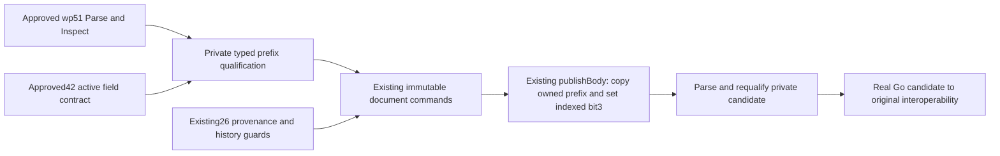

# Reordered active-prefix admission — temporary architecture decision

Architect Alphonso, action-plan governance, existing M1. Audience: independent architecture reviewer, then planner and document implementer. Revision2 resolves independent architecture review R1; exact prior revision and complete cycle1 review are retained under history/revision-1 and reviews/cycle-1. The first draft mistakenly selected the post-print cache with the pre-print counter; that rejected combination is not a qualified source. This is a proposed C milestone, potentially WP44, not an authored task, source change, VM grant or product approval. Approved42 source d77c5f55/review a773c629/event01M68DDX440YE00WQPEBPY2R3A supplies research authority. Approved25/26's actual lane-e private immutable model is the consumer. ADR0003 lifecycle boundaries and the earlier approved23 mutation ADR remain binding; neither is silently rewritten.

## Decision

Extend the existing document mutation admission to one additional **logical index order**, preserving the existing body-command implementations and explicit must-format emitter policy. Admit only the proved active, fully accounted one-row-resource prefix; refuse deleted, unowned, unknown, aliased and unsupported scalar/resource variants. Separate format safety from command/history qualification. No prefix hash whitelist, embedded original image, template reconstruction, codec/parser fork, native normalization, new document lineage, constructor or public mutable policy setter is introduced.

Only internal/document/** is C's proposed owned scope. Required direct dependencies are WP25, WP26 and WP42; inherited reader/research dependencies stay inherited. Source acquisition/storage/editor/TUI interfaces remain unchanged. C is not an executable editor milestone or a claim that a loaded resaved document can already be edited through current TUI. E stays unauthored pending actual43 schema audit plus C. Any actual original interoperability uses a frozen owned driver/producer closure and root-coordinated grant after offline preparation, never this temporary decision as permission.

## Concrete structural predicate and seams

Current admission.go already consumes wp51.Inspect spans and validates72 individually explained field values, local pool/AFC relationships, complete nonoverlapping prefix ownership and paired body grammar. It permits physical relocation, but explicitly requires index sequence7/15/12/6/8. Actual disabled42 resaves use6/7/15/12/8 and are therefore refused. Their same derived324-byte length does not make them the old schema.

Retain mutationAdmission as one private admission authority; implementation may return a private qualification value containing schema class and indexed flag offset instead of its current int, but no exported capability/config API is needed. CheckMutation must call the same authority; every mutating entry point and candidate revalidation uses it. Qualified resource fields remain individually typed/constants with documented meanings; locating packet owners is by type and checked actual index spans, never array-position assumptions or hard-coded file offset66/256.

- Keep the reader's identity/version/encryption/reserved-header and arithmetic/traversal checks. Mutation still demands two50-byte index blocks, first at16, correct followed next link, terminal next0, count5, and exactly five unique live owners. First block has four live slots, second has graphics slot followed by three wholly zero unused/end slots. Validate unused bytes that the framing reader intentionally ignores. Unknown index orders, extra entries, duplicate owners, FFFF/deleted and reserved packet types refuse before a candidate.
- Accept the existing7/15/12/6/8 order and the newly qualified6/7/15/12/8 order only. Type8 stays last in the linked index order and its two-byte zero-count payload ends at body start. Require live lengths7=14,15=86,12=90,6=16,8=2. Derive all offsets/total prefix length from checked spans; no admission based only on324, fixed physical ordering, digest or a fixture identity.
- Sort header/index/live extents and demand complete exactly-once coverage of [0,bodyStart), with no gap/overlap/alias. BodyStart must agree with actual reader and gap index. No prefix/body relocation occurs. Fixed widths/counts currently imply324; that is a consequence rather than schema selection.
- Preserve existing literal resource field rules for the old order. For the new order, require the actual42 **pre-print** one-row Courier10cpi/Standard Printer field set: descriptor-cache bytes **e7 24**, all72 individual field values as bound to the actual pre-print ledger in the manifest, packet6 flag00 or emitter-produced08, counter01, zero graphics. All24 designated G1/G2/G3/EDIT sources (three disabled grammars, two fresh each) have e724/counter01/flag00. FIN is1172/counter02/flag00 and remains refused; new-order1172/counter01, e724/counter02, every other unqualified cache/counter combination and other flag bits are also refused. Existing old-order cache rules are unchanged; do not take the Cartesian product of old-order allowances and new-order fields. No hash/counter computation or Cartesian expansion of observed variants is inferred. The source fixture's digest is test provenance only.
- Validate packet15+18 as the documented pool-relative u16le reference into unique packet7 and its bounded NUL-terminated name, and all AFC sentinels/row indices against the unique86-byte row. Retain the inherited specific disabled/default attribute rule. Other fonts, PS tables, nonliteral descriptors, resource versions, additional rows/packets and C02401C0 remain unsupported. Header/payload fields keep approved72-field representations, including endian and units.
- Body grammar and limits remain printable WP ASCII20–7E, at most two sequential matched nonnested Bold pairs (including already-supported empty pairs), 65536 native bytes/16384 mutation tokens. No hard returns, controls, non-ASCII/Compose, new attributes, nesting, graphics or body-length cache is invented. Read-only Parse/Export keep their existing wider policies.

## Operations, history and immutable publication

Choose **all already-admitted25/26 body transformations, with all their existing command/history guards intact**, rather than insertion-only. This is an explicit architectural judgment requiring independent review and implementation proof, not an additional original command observation. No operation-level capability split is needed for this qualified format class.

The positive argument is stronger than unchanged unknown bytes: the new prefix has no unknown extent; every active/header byte is explained by the same typed72 fields, indexes and fixed resource relationships as the old class. Its live references stay entirely within the fixed prefix or declared resource/cache domain. There is no admitted prefix reference into body text and no stored body length; body termination is EOF. Its body start is unchanged. Existing commands operate on immutable token/gap spans and captured native fragments, not packet physical/index ordering. Replacing an old qualified prefix P with the newly qualified Q therefore leaves the domain transition on body tokens, relative gaps and command provenance identical; publishBody copies Q and updates only Q's indexed must-format bit. This is the representation-independence argument for inherited transformations. It does not establish unknown-resource/deleted/slack independence.

Enabled operations remain exactly those of approved25/26: InsertASCII and TypeoverASCII; existing qualified ASCII/code/block deletion and repair; and only existing qualified preview/restore paths. NewHistory is allowed for this structurally admitted class, but it does not supply missing command provenance. The full26 guards remain: empty/unbrowsed direct-pair history refuses; code-pair and closing-repair knowledge needs the measured sentinel/pre-browse/Right-separated shape/view; CountKnown stays false for bounded hidden-entry observations; extra browse/non-newest/repeat Restore and unqualified interleavings/declines still refuse. AfterEdit's private ASCII receipts and unqualified-effect handling are unchanged. An admission success is not a universal Delete/Undelete permission.

Retain one private revisionState, original image and gap authority. No exposed mutable state, public field-offset/prefix setter, caller-provided qualification or wrapper-pointer retention. Cursor/Revision/History/Preview/pending Deletion and private receipts bind immutable state, not reassignable public wrappers. Same bytes parsed twice have distinct revision identity. On refusal no candidate/revision/history is partially published and all original fields/cursor/selection/view/preview remain unchanged. Export/OriginalExport/token getters copy owned bytes. Old cursors/history remain bound after wrapper replacement; accepted edits produce one fresh revision except existing same-byte/no-op rules. OriginalExport keeps initially loaded bytes across every derived edit. Constructor/New-origin semantics do not enter C.

## Explicit flag policy resolution

SDK51 printedWP11/PDF24 defines packet6 bit3 as a request for document formatting. Approved23 contract/field-ledger and mutation ADR explicitly allow setting only that bit for supported body changes. Approved25's sole publishBody implements it, including declared body-preserving repair forceFormat handling; its tests already distinguish original after-Off00 from writer08. Approved26 uses the same publisher and retains those semantics.

**Retain that emitter policy for both index orders.** Body-changing candidates set indexed flag08 by OR, preserving other admitted bytes. Qualifying forceFormat repairs retain their existing metadata-only revision rules. No-edit export, same-byte typeover, previews, declines, navigation and refusal remain byte-identical and do not set a bit merely because a save was requested. Do not clear an existing08 or use filename/source history/packet order to guess original FastSave setting: no such mode is serialized by this decision.

Original42 disabled G3→EDIT saves00. Wordling may intentionally emit08 under the approved must-format policy; the original does not expose its cache/format scheduling algorithm and this policy does not claim one. Native differential validation must first record the exact unmodified original00 expected output and the raw Go08 candidate, locate packet6 through indexes, and permit **only** this explicit indexed difference for those operations. Equality after blindly masking byte66/256 or normalizing whole prefixes is forbidden. Exact no-edit identity remains required. This difference needs new actual candidate→original proof on the reordered family, not just SDK wording or the old-order interoperability witnesses. Unexpected other native bytes/behavior/stream differences block C. Changing to preserve00 or introducing a mode toggle would be a separate reviewed policy amendment; it is not chosen here.

## Real acceptance and producer/original path

C must implement structural positive/negative public-API tests using both actual42 fresh witnesses at all designated new-order e724/counter01 pre-print stages and the old25/26 regression corpus. Deliberately change printable values to demonstrate semantic data operations, not fixture replay. Test physical relocation only through the fully checked typed structure, clearly labelling synthetic tests; they are not new original evidence. Mutate each field/index/extent/reference, add unused garbage, alias/overlap, deleted entry, unowned gap, wrong new-order cache/counter, extra/unknown owner, malformed pool/AFC, body function and bound. Assert exact typed refusal plus original/cursor/history invariants. Ensure actual FIN1172/counter02, synthetically rehashed new-order1172/counter01 and e724/counter02, unsupported flag/cache/counter values and every564 family remain read-only/refused while Export is exact. Positive tests must prove all72 individual values and structural/reference checks on every designated pre-print witness; candidate08 is the explicit emitter-derived state requiring interoperability, not an original42 observation.

Representative format-independent command classes must cover insertion at beginning/middle/EOF, repeated typeover before/after codes and same-byte no-op, ASCII deletion/grouping, attributed deletion/restore, opening and closing body-preserving repair, qualified direct-pair deletion/observed Restore, and two-pair growth-limit refusal. Compare actual native body and relative gaps against approved semantics; preserve all CountKnown and unsupported-context behavior on new-order inputs. No success predicate is a swallowed error, detached helper or expected-buffer replay.

Actual Go candidate production must start from original42 reordered inputs via document.Parse and invoke those real public APIs and required history/command provenance. Retain exact producer source, argv, source/input/output/revision/gap/operation/native hashes and resource provenance. Use lawful scratch files through the already-reviewed candidate-verifier contract and inherited actual helper APIs. Declare and freeze exact finite candidate/normal-exit/print expectations and attempt cap before requesting root VM grant. No host-made prefix seed, replacing source with a legacy fixture, stale candidate, source-normalization adapter or unchanged-original control labelled Go candidate.

Before that grant, derive distinct **whole native** candidate classes from real producer outputs. Keep every operation/provenance test even when different operations emit the same native bytes; native class deduplication never collapses history semantics. At minimum include changed ordinary ASCII, retained one/two-pair format, pair-removed plain text, and literal-empty-pair repair/restore outputs where distinct actual bytes result. Use two fresh original guests per distinct candidate/native class; freeze the measured count after actual production rather than inventing a class count from file sizes. A representative interop omission requires an explicit reviewable blocker, not silent sampling. This bounded C should not expand to an unrelated full UI or exhaustive DOS history mission.

Each permitted guest explicitly captures/disables FastSave using the approved42 setup contract before retrieval (not inferred from its input), retrieves the exact Go native candidate, captures normal/Reveal content/code and known cursor/gap witnesses, performs the separately declared subsequent original edit, saves a distinct pre-print snapshot, prints full selected-profile bytes, saves a distinct post-print snapshot, reaches captured normalDOS, then stops/extracts under the actual shared lock/master contract. Every added Save/setting action and name is frozen before grant; no sensitive history observation has a hidden Save interleaving. The actual pre-print snapshot must satisfy the new **e724/counter01** structural and complete72-field predicate, reopen in Wordling and undergo a second real admitted Go edit with original lineage/gap preservation checks. If that original result instead changes to1172/counter01, counter02, another unadmitted cache/resource combination or another prefix family, this required acceptance is blocked rather than skipped or normalized. Compare byte-exact PRN against the corresponding original-only witness for identical logical commands/resource profile (if missing, the frozen experiment must obtain a separately identified original control, counted in the finite budget). Validate every native field delta, including indexed flag cache allowance, and reopen the resulting original output with actual Wordling reader; refuse unsupported resaved output rather than normalize it to editability. The declared disabled-FastSave path is required to attempt the complete Go→original→Go re-edit acceptance without requesting564 mutation permission. Post-print counter02 and any unexpectedly produced564 result remain exact read-only/refused observations in C; the final print snapshot does not substitute for the required admitted pre-print re-edit snapshot. No future producer or guest is run by this decision.

Run actual Go format/build/tests/vet, targeted ownership/race/refusal tests and predeclared bounded mutation/history fuzz on changed admission/publisher reachability; recheck real configured catalogue/scenario checks. Old26 history negatives are mandatory on new prefix: no generic empty/unbrowsed pair-delete, false hidden count, nonempty cancel, invalid view/interleaving, repeated Restore or continuation after unqualified AfterEdit. Independent implementation review must inspect both newly reachable success paths and negative guard retention. Candidate framing/native field checks and final DOS are necessary but do not alone establish interoperability.

## Separate564 research: existing evidence first

No564 mutation admission is included. New temporary existing-564-provenance-observations.json inspects all three baseline grammars' stages; both fresh witnesses are identical under approved42 seals. Its63 deleted/unowned extents all have byte-for-byte matches within already-typed live payloads. In G1 the deleted14 and90 bytes match pool7 and printer12, deleted16 matches packet6, and deleted70 matches packet15 relative16. In G2/G3/EDIT the deleted16 at256 matches packet6. FIN's deleted14/86 at322/336 match pool7/font15; unowned[252,256) matches printer12 relative86–89 (tail of saved printer time/current font-size/typeface fields). This is useful literal provenance, not proof of unique origin or current reference authority; zeros/repeated values yield multiple possible matches.

SDK51 printedWP8/PDF21 identifiesFFFF deleted packets, notes their bytes may remain under FastSave, and describes purging with FastSave disabled. It does not by itself type arbitrary stale payload fragments or establish that every raw byte is ignorable under every body edit. Current active pool/font/AFC links are bounded, but existing42 could not adjudicate whether a residual/cache relationship outside those interpreted roots remains relevant to retrieval/format/print. The precise missing contract is: which roots are active, whether any actual/deleted/unowned/cache field refers to another active packet or body/text position, how truncated70-byte residual font-tail is interpreted if at all, whether reused extents/old index records are exclusively inert under the declared prefix schema, and why preserving the four unowned printer-tail bytes cannot alter body-dependent behavior. Establish exact field/extent and reference ownership, not just payload resemblance, reader success, deletion marker or repeated stabilization.

Recommend a separate research proposal R564, with disjoint new scripts/reference/resaved_prefix_relationships.py and docs/research/continuation/resaved-prefix-relationships/**. Dependencies23/14/22/39/42 and genuine inherited runner/reader prerequisites only; **no44/C, document, editor or TUI consumer dependency**. Stage1 is offline: audit all72 existing images and exact approved23/42 SDK/manual locators; give byte/field/endianness/root graph including old/current index ownership, all aliases, residual extent boundaries and interval provenance; decide whether an explicit closed structural family has a defensible positive reference argument. A negative/unresolved conclusion is valid and retains read-only. Current byte-provenance evidence is not that completed argument. No new originals are automatically necessary or granted.

Only if Stage1 identifies an actual unresolved original behavior that new originals can discriminate should Stage2 propose a separately reviewed finite frozen plan. Smallest candidate is two existing original42 max2-Bold inputs (G3 deleted-only and FIN deleted+slack) × two fresh guests =4 maximum attempts including failures, with declared FastSave-disable/Retrieve/new-name Save/print/subsequent edit observations and original/native captures, if supported by exact manual/approved helper preconditions. This may test documented purge behavior but cannot prove all hidden references by finite success; any remaining gap stays blocked. Inputs must be the original42 artifacts with prelaunch hashes, not edited host variants. More grammars/setting/resource changes require a new justification and cap; no unbudgeted calibration/retry. Root grants and unchanged custody/exit helpers remain mandatory. Later564 implementation is a separate document package depending on this actual approved research, never a code→research→same-code cycle.

## Delivery order and retained scope

Proposed44/C owns internal/document/** and directly depends25/26/42, sequential on existing lane-e. R564 is an independent new research lane, after42, with no edge back from C. Future E depends actual approved C/43/schema audit and storage41; it remains unauthored. Current27/28/etc prompts and43 research are untouched. The machine manifest contains actual43-WP dependencies, old21 lane identities, proposed ownership and pure acyclic package/lane proof; it is not canonical finalization/task allocation.

All other M1 native/body/format/resource/language/platform/UI/search/layout/merge/macro/printing/preview/companion/utilities/historicalDOS/input/overwrite/backup/recovery and discovered nested-leaf duties remain open. All38 obligations/91 groups/36 workbook lessons remain visible. Qualified field format and selected command/provenance cases are component milestones, not complete scenarios/FRs, release acceptance, accepted M1 or M2/PDF. Primary/source/prompt/lifecycle/grant/master bytes are unchanged.
