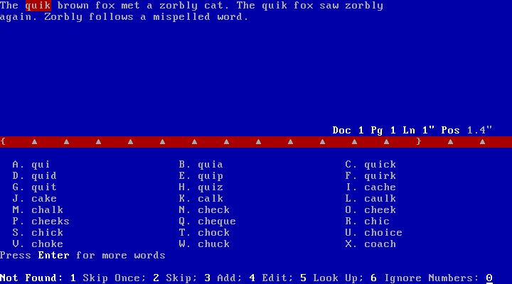
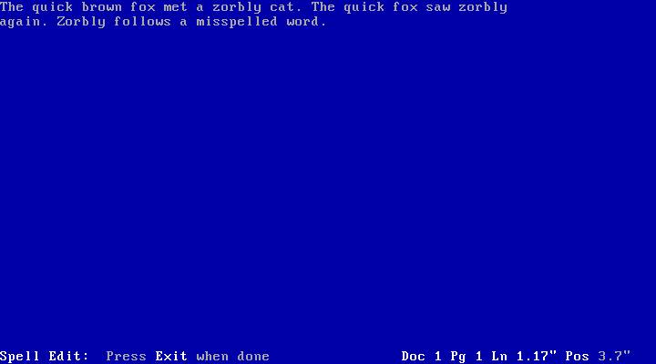

# Original WordPerfect 5.1 proofreading workflow study

2026-11-05. Research input to WP78, not milestone acceptance or product qualification.
The live 03/09/92 original is the release-specific oracle. The June 1992 Reference
manual, printed pp. 587–598 and 926–927, is documentary support. The established
reference image uses FreeDOS 1.4 and mixed-date printer resources; it is not a claim
about a pristine shipping installation. No application, planning, or lifecycle files
were changed by this study.

## The experience to preserve

Proofreading remains inside the document. The questionable word is highlighted in
its sentence, its position remains visible, and suggestions appear below a red
ruler. One letter selects a suggestion and immediately advances to the next issue.
Inline correction temporarily gives the whole screen back to the document; F7
resumes the scan. This is a continuous, contextual editor workflow, not a separate
modal spelling dialog.

At 80x25, the observed checking screen has document context in rows 0–10, position
status at row 11, red ruler at row 12, suggestions beginning at row 14, continuation
hint at row 22, and action prompt at row 24. Coordinates are zero-based. The sample
`quik` occupies row 0 columns 4–7 with attribute 0x47 (light gray on red), surrounded
by ordinary text at 0x17. Ruler is 0x47; prompt title/action numbers and portions of
status use 0x1f. Each capture retains the full 4000-byte character/attribute grid,
720x400 PNG, original PPM and paused-guest status, so visual review need not infer
focus or highlighting from plain text.

## Primary continuous journey: proof/

The typed and saved starting text is:

    The quik brown fox met a zorbly cat. The quik fox saw zorbly again. Zorbly follows a mispelled word.

`BEFORE.WP` is an in-guest copy of the initial save, exported only after the VM was
stopped. The following references are capture directory prefixes; exact key calls
are preserved in `proof/trace.jsonl`.

| Step | Action and observed outcome | Capture |
|---|---|---|
| Open | Ctrl+F2 presents Word 1, Page 2, Document 3, New Sup. Dictionary 4, Look Up 5, Count 6. F1 cancels this initial menu. | 01 |
| Document scan | Ctrl+F2, 3 starts at the first issue, not the previous document cursor at its end. First `quik` is highlighted; C is `quick` in this exact dictionary. | 02 |
| Correct | C replaces first `quik` and advances to first `zorbly`, which has no suggestions. The later `quik` has not yet changed. | 03 |
| Skip once | 1 advances to second `zorbly`. The later `quik` is now `quick`: replacement is applied when encountered during the same scan. | 04 |
| Skip remainder | 2 skips this spelling for the remainder of this spell-check, including the capitalized `Zorbly` later in this document. `mispelled` is now highlighted; A=misspelled, B=misspelt. | 05 |
| Edit | 4 restores full-height document view, with a Spell Edit footer instructing Exit when done. Cursor is at the suspect's start. Right, Right, s inserts the missing s in place. | 06–07 |
| Resume | F7 resumes checking and reaches a word-count acknowledgement (19 words). | 08 |
| Finish | Space acknowledges and returns to ordinary editing, position Ln 1.17 inches, Pos 5 inches. | 09 |
| New pass | Ctrl+F2, 3 again flags the first `zorbly`: Skip is not a permanent dictionary change. | 10 |
| Interrupt | F1 stops this pass and produces a partial word-count acknowledgement (7 words). F7 acknowledges and returns to ordinary editing at the interrupted suspect, Ln 1 inch Pos 3.6 inches. | 11–12 |
| Add | A new document pass, then 3 Add on `zorbly`, proceeds to completion. A further new pass accepts it. | 13, 17 |
| New supplementary file | Ctrl+F2, 4 prompts for a supplemental dictionary name. Entering SPELLADD returns to the Check menu. Document 3 flags `zorbly` again; Add 3 accepts it and finishes. | 18–21 |
| Block | Selecting the beginning of the document with Alt+F4 and arrows then Ctrl+F2 checks directly, without the initial scope menu. This selection yields a two-word count. | 22–23 |
| Configured paths | Shift+F1, 6 displays Main and Supplementary spelling paths both C:\WP51. | 24 |

Final `PROOF.WP` contains both `quick` corrections and `misspelled`, while the
three zorbly/Zorbly occurrences remain unchanged. Soft wrapping remains a native
0D byte. The before/after document bodies and hashes are in `proof/files.json`.
The final save was observed on screen before shutdown/export.

## Independent fresh probes and scope details

`repeat/` starts from another hash-checked master copy. Checking Word 1 at `quik`
shows the same A–X suggestions and C=quick. Selecting C changes only that word and
returns to the initial Check menu (01–02). Selecting Page 2 within that same spell
invocation automatically corrects the later `quik`, then stops at zorbly (03).
Thus remembered replacements can survive returning to the Check menu within the
same invocation. This is not evidence they survive exiting and reopening Speller.
The document has one page; page-boundary scope remains untested.

A verified block selection is visible in `repeat/11-selected-block`; Ctrl+F2 checks
the selected opening words and returns a count of two (12), while zorbly outside
the block remains in the document. It does not offer a second scope menu. The
manual says dictionary-selection, lookup, and count choices are unavailable for
block checking; not every contextual action was exercised in a flagged block.

The same fresh run adds a second paragraph with a repeated word, mixed case, and
an alphanumeric token. Original live observations:

- Double Word displays `1 2 Skip; 3 Delete 2nd; 4 Edit; 5 Disable Double Word Checking`.
  Choosing 3 turns `The the fox` into `The fox` (13–14).
- Irregular Case displays `1 2 Skip; 3 Replace; 4 Edit; 5 Disable Case Checking`.
  Choosing 3 changes `tWo` to `Two` directly (14–15), not to lower-case `two`.
- `123abc` is then a Not Found issue with suggestions. Choosing Ignore Numbers 6
  ends this sample pass (16). Later-number behavior was not separately witnessed.

`repeat/06-block-only` is an exploratory mislabel, not block acceptance evidence:
the screen is still checking zorbly. Subsequent captures establish a confirmed
ordinary editor state, actual Block on state, and the scoped count. The attempted
final save in this run was not settled before shutdown; export found no files.
Therefore this run supplies screen behavior only, not native-output proof.

## More suggestions, lookup, and exit: suggestions/

A third fresh master-copy run independently reproduces the first `quik` suggestion
page (01). Enter moves to the next page, reusing A–Q letters, with P=quick (02).
The document and highlighted word remain in place. No more-words hint is shown on
this last page. An Enter on an empty list in the earlier repeat run did nothing;
that capture is not proof of list pagination.

Look Up 5 leaves context and existing list visible and prompts for a word/pattern
(03). Entering `quick` gives a phonetic candidate list and Select Word prompt (04),
not an automatic exact-word replacement. Selecting A chooses the displayed `cache`,
replaces `quik`, and advances to zorbly (05). This deliberately records what the
original did, not what a modern spell checker might predict. The saved LOOKUP.WP
contains `cache zorbly`; byte evidence is in `suggestions/files.json`.

F7 by itself on the Not Found screen left it unchanged (06). F1 produced the
partial-count acknowledgement, then Space restored ordinary editing (07–08).
Implementing F7 as unconditional exit from every spelling state would contradict
this observation. Lookup nested cancel, wildcard matching, and nonempty-list arrow
behavior need additional focused tests before claiming their exact contracts.

## Dictionary provenance and persistence

Master disk has no default .SUP file. It contains US `C:\WP51\WP{WP}US.LEX`
(363165 bytes, DOS timestamp 1991-05-31) and `WP{WP}.SPW` (13126 bytes, same date).
Main and supplementary directories were directly observed in Setup. The reference
manual describes this LEX as the main/common spelling word lists and SPW as code
required by the Speller. SHA-256s are in `proof/dictionary-provenance.json`.
WP{WP}US.LCN was also hashed for environment provenance, but is not asserted to be
the spelling dictionary. No proprietary LEX/SPW/LCN bytes are included here.

Add creates `C:\WP51\WP{WP}US.SUP`. New Supplementary Dictionary with SPELLADD
creates the exact filename `C:\WP51\SPELLADD`, **without appending .SUP**. Both
were absent from the master and present on the stopped private disk after their
respective Add operations. Both are identical 73-byte native WP-format files,
with header document offset 66 and body `zorbly` followed by 0A. Only this original
user-authored word is in the exported supplementary samples. Files, sizes, full
hex and hashes are in `proof/supplementary.json`.

After stopping and restarting the same private disk, a new blank document
containing zorbly passes Document checking with count 1 (`proof-restart2/01`). The
first restart encountered the original's stale running-copy lock question;
`proof-restart2/00` records it, and N was appropriate because no other WP process
existed in that isolated guest. The restart records its disk hashes and command.
This confirms disk persistence beyond the first process. It does not separately
qualify custom-dictionary selection persistence across restart.

These external resources remain copyrighted proprietary reference material, not
Apache-2.0 project assets. Availability in this local reference image is not a
redistribution license or a promise that end users own the same dictionary.
The checked-in material is workflow evidence and our own authored samples. Exact
lexicon acceptance, phonetic ordering, language coverage, and suggestion ranking
must not be claimed equivalent from these few examples. A product dictionary
provider decision needs explicit licensing/provenance plus a separate accuracy
contract; faithful pane, keys, session state, and supplementary behavior can be
specified independently. Do not silently label a modern dictionary WP-equivalent.

## Reproduction, failures, and boundaries

`control.py` is frozen in each fresh run; it calls `guest.start`, which verifies
master boot/disk, QEMU and firmware hashes before making an independent copy. Each
run has its own socket and private disk, and its startup environment and command
are retained. Every capture pauses guest execution to obtain consistent pixels
and VRAM, then resumes. All exports were performed after socket disappearance;
all research guests are now stopped. The manifest covers every saved artifact.

Failures are retained, not converted into passes: proof DOS wildcard commands
failed because the harness lacks `*` typing, leaving a partial command. F1 canceled
it, and dictionary files were subsequently inspected/exported from the stopped
disk. Capture 15 is that DOS error state, **not** added-word acceptance; 17 is the
successful acceptance witness. The repeat final-save/export failure is described
above. Initial restart timed out on the running-copy prompt; second restart
handled/captured it. A suggestions save wait used wrong capitalization and timed
out on the correct prompt; an overlapping text read also timed out on QMP. After
both calls finished, the real filename was entered, the prompt disappearance and
saved document screen were observed, and export succeeded. `failures.json` indexes
these limitations, with original action failures in each trace.

The observed final output and context checks are in `checks.json`; these checks
verify this evidence bundle, not Wordling behavior. Still unqualified: multi-page
scope, unknown-word block option differences, read-only/missing/full/locked
supplementary dictionaries, lookup wildcard/cancel edge cases, Unicode/Linux
terminal delivery, or exact lexicon equivalence. WP78 should turn the accepted
observations into a reviewed versioned journey before implementation/review uses
them as a formal acceptance oracle.
