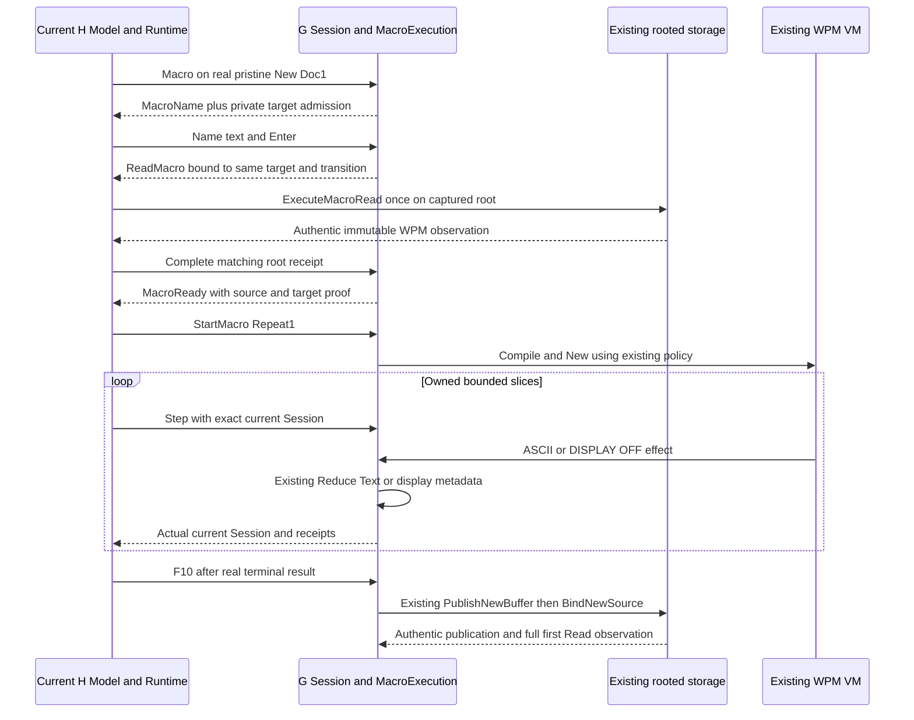

# Genuine New Doc1, one macro invocation — proposed composition contract

Status: **READY_FOR_INDEPENDENT_DESIGN_REVIEW_ONLY**. Audience: independent design reviewer and root task author. This is a source-backed normative proposal, not a task reservation, implementation permission, executable prototype, native-output test or conformance promotion. Full38 requirements/91 groups/36 lessons/nested SC001–005/M1 remain OPEN; M2/PDF remains gated.

## Decision and evidence boundary

Permit the real initialized pristine New Doc1 to enter the existing Macro-name/rooted-WPM/VM path once at default Repeat1. Retain the exact native New lineage and use the existing ordinary ASCII reducer plus DISPLAY OFF sink. Do not change WPM framing, VM grammar/evaluation, document/storage/native writer, input decoder, cmd, modules or profile serialization. The minimal next delivery is a G core admission/composition package followed by H production integration. No P61 code, semantics or approval is a prerequisite.

This is deliberately narrower than general macros on every New buffer. WithMacroRepeat's New exclusion and switchDocument's New exclusion remain unchanged, including NewAnchored. A genuine edited-then-empty New, another screen, post-prompt-cancellation/missing-source history, old root read, active macro or publication state cannot become a fresh initial admission merely because its body is empty. “Once” means one VM invocation with Repeat1 on the admitted current chain, not a new global revocation model for persistent Session values.

The chosen first composition is **root WPM only** on a New target. The existing pure control-flow grammar can select ASCII/display effects; a NEST/CHAIN request on this new target returns the existing typed `Resolution{State:host-error, Err:Refusal}` before any child-name lookup/read/IO. Current VM maps that to failed/HostFailure, not CommandError or a catchable NotFound. Earlier actually applied words remain. This requires no new VM syntax, source scanner, digest allowlist or fake nested success. Existing loaded-target nested behavior is untouched. Broader New-target nested acquisition is a separately reviewable expansion, not an implicit consequence of the FLOW success.

Primary source is immutable approved H62 e71524f5435057bc6f8490dc7ec6930683c9ba8c, containing the actual approved G47/36, document46 and storage41 closure. `source-proof.json` supplements the85 individually verified recon Git references with15 exact public references and method anchors; the sets overlap and are not claimed as100 unique files. Deliberate New guards were introduced by first-binding commit09db703822a97d41d9c4e4cd7a5e2f3c10d5f131, not an obsolete bug.

Both original205 recipes author FLOW in the Macro Editor, leave with F7, then AltF10 FLOW, show TRUEFALSETAIL on Doc1 and save FLOWOUT. There is no ShiftF3. They qualify this selected output/control flow after that captured prelude. They do not prove arbitrary untouched-startup defaults, hardware caret/gap, all New contexts or this future host implementation. Original132 explicitly records ABC then ShiftF3 to blank Doc2 before Esc3/AltF10. It supplies no startup Doc1 Repeat3 or fresh Doc2 constructor authority.

## Ownership and flow

The diagram is explanatory. The predicates and stages below are authoritative. Domain G never depends on H/UI tokens, menu rows or terminal dimensions. H does not independently reconstruct document history/native admission or clear the Session's source/pending state to make it fit.

## G initial admission: evaluate before MacroName

Add a private, explicitly named New-entry predicate near the current `Session.Reduce` Editing/Macro branch. Preserve the old loaded branch exactly. Only the new branch may replace the deliberate blanket refusal for this one context. Public methods remain `New`, `Reduce`, `StartMacro`, `MacroExecution.Step/Resume/HostStop` and existing first-save APIs; no new exported document/source setter or separate macro-text buffer is needed.

The New-entry predicate must observe actual private state:

- initialized Session, nonzero bufferID/transition, native Document present; `native.Birth().IsNew()` true and nonzero opaque Birth; actual `NewUnpublished`; no loaded/source document, no first-publication state or other-screen Session;
- Doc1 Editing, native current revision equals the retained nonzero GenesisRevision, token count0/cursor gap0, numeric Session.Revision1, operation sequence0; no nil/fabricated/parsed-empty replacement and no edited-empty approximation;
- normal Insert, no Reveal/block/selection/deletion-question/history preview/Home prefix, repeat1, no macroOwner/macroReady/macroDelivery/pending;
- untouched constructor name/draft/original/caret/target/targetDir/targetName/fromExit/touched/prefill/provenance/publication/saved fields, no notice/receipt/detached/first result. Constructor Provenance is numeric0 (the Text enum), not a string. A copied diagnostic or zero count cannot authenticate this state;
- actual constructor history retained: valid, never-used history over the same genuine New revision, qualified with known count0 and no preview/deletion fragments. These facts come from New→document.NewHistory, not a general “unknown means empty” rule. Dirty/history facts are measured before and after; do not force Dirty or manufacture history to satisfy the predicate.

Host-only IO/work/current-UI constraints are separate below. G can refuse additional concrete invalid private combinations; it must not silently broaden admission by checking only IsNew, nil Source or zero tokens.

On successful Macro entry, retain the existing `interrupted()` history barrier. It calls the actual `History.InterruptGrouping`; that may advance a history handle and seed qualification, even with an empty known stack. Do not demand equality to the original history handle after this legitimate command, and do not create a replacement NewHistory. Native Birth/genesis/current revision/content, dirty/name/source/save state and first-save authority do not change. Enter the actual existing MacroName mode with its original prompt and default extension/name validation.

Capture a private immutable New-target admission descriptor BEFORE `filename(MacroName)`. It is a fact about the admitted target, not a boolean permission transferable to another Session. It must contain or reference the genuine Birth, genesis, admitted native revision, buffer identity, screen1, initial revision and the specific accepted entry transition. It contains no serialized native bytes and no external setter. Store it only in G's existing Session/acquisition/driver orchestration, never in exported Snapshot as mutable authority. Proposed private field/helper names are intentionally not prescribed as a public ABI.

Name typing changes draft/provenance/transitions. Do not rerun the constructor predicate after name entry, after accepted root read or after the first Text effect. Instead validate the current stage against the descriptor and current target. On Macro-name F1, cancelled/detached root read, root error, compile failure/cancel and terminal execution, release the proposed admission stage; retain genuine diagnostic source/receipt history according to existing APIs. No cancellation resets sequence/history/native/source/notice to counterfeit a fresh constructor. Returning to normal Editing allows existing ordinary edit/save/exit behavior; a new initial macro entry after a prior attempt remains excluded by this deliberately strict first slice.

## Root acquisition, ready state and driver authority

The existing rooted path is `editName(Enter) → begin(ReadMacro) → ExecuteMacroRead → acceptedMacroResult → complete(ReadMacro) → StartMacro`. Keep it real. The WPM source is separate from the DOC Source: storing MacroSource or `Last.Result.Macro` must never populate `Session.Source`, a native document name, SavedRevision or first publication.

For the new branch only, carry the descriptor into the actual private root request proof and accepted acquisition. Bind the issued private proof to operation/reducer revision/native revision, run ID, Repeat1, request0/zero parent, screen/buffer/Birth/genesis, chosen macro basename and captured opened Directory capability. Public Intent/Result/Directory/Source/Image copies remain observations; replacements can refuse but cannot steer an accepted IO operation or new target. Continue to read through the private captured Directory in ExecuteMacroRead, never an independently reopened equal path.

The existing macro read proof does NOT contain every proposed New-target fact or an exact root transition today. Therefore “remove the IsNew condition and reuse all existing proof unchanged” is not this design. The implementation must add the missing New-only issued/ready transition binding. A minimal source-compatible place is the same central Reduce finalization seam already used to adopt `firstProof.transition`: issue one private New macro request transition and let Reduce adopt it, so pending Session and private proof agree AFTER Enter. Do not bind a pre-Enter transition and then let the ordinary final `advanced()` silently invalidate it. At accepted root completion, the existing `complete` advances the Session before constructing macroReady; bind the accepted descriptor/source/request to that actual ready transition. These are private G changes, not a public Result mirror, mutable “current” singleton or H-supplied token.

Completion must validate the actual current pending root proof, target descriptor and stage BEFORE clearing Pending, recording an applied Last receipt or constructing MacroReady. It must preserve the authentic pending request when a forged/foreign/stale reply fails. Existing full source/name/DirectoryID/Image SHA checks, sealed observation and copied source custody remain. A late reply after cancellation may become a truthful detached diagnostic; it cannot create MacroReady or run. Missing WPM follows existing MacroError/F1 recovery, without changing DOC bytes or turning a read failure into a saved document.

`StartMacro` validates the accepted acquisition and its ready transition, the same target Birth/genesis/buffer/screen/native-at-entry, no publication/source/pending target change, and Repeat exactly1. It compiles the actual accepted immutable Image with unchanged `vm.Policy{ASCII:true,DisplayControl:true}` and existing limits. Search/key programs still fail before any effect. Program/source identity is the real accepted WPM, not expected literal text or a fixture digest selector. The root source's actual body offset75 is odd; use existing native word spans, never absolute-even scanning. After successful construction, use the existing private macroIdentity/expected transition/buffer/screen state and actual mutable driver. The driver must retain the new target lineage fact so later entry code cannot accidentally drop it.

Each Step/Resume/HostStop must keep existing `valid()` owner/buffer/screen/exact expected-transition/reentrancy/terminal checks. For the New composition also preserve original Birth and genesis, NewUnpublished/nil DOC Source/no first-save state and the owned current native revision/cursor chain. Current native revision may advance on successful ordinary ASCII; it is NOT required to equal genesis after the first effect. Do not reinitialize, parse, replace, retrieve or rebase the target. Native-target eligibility cannot be reduced to equal byte content or numeric revision alone. Root-only New execution never creates a child ReadMacro Intent; a foreign/late nested receipt cannot be consumed as a continuation.

“Single use” has precise limits. Session is persistent and existing APIs permit independent fork branches, including constructing separate drivers from copied MacroReady values. This proposal does not globally revoke every old G Session, add a shared mutable consumption bit or claim all standalone forks are stale. A driver consumes only its own exact next transition; copied driver handles share the same private driver, so duplicate Step/Resume is refused once its expectation advances. Actual UI/IO/worker ownership is serialized by H and is what prevents an earlier copied Model/Session from replacing the live user chain. Tests must distinguish valid independent pure forks from attempts to retarget the authentic driver/runtime.

## Effect, history, failure and budget contract

| New-target event | Normative behavior |
| --- | --- |
| Printable one-word ASCII literal | Existing `Apply` calls the same `Session.Reduce(Text)` with macroDelivery, then retains the actual new Session. No unexpected Intent is permitted. Record real source/span, before/after revision/gap and actual result. |
| DISPLAY OFF FC0C | Existing typed metadata receipt, no DOC revision/gap/name/source/dirty change. H renders its captured chosen frame until actual terminal result. |
| IF/ELSE/GO/LABEL, supported ASSIGN/VARIABLE/FOR/WHILE/FOR EACH/BREAK/NEXT/normal QUIT | Existing Compile/VM evaluation only. No new grammar or evaluator. They can only select the allowed sink effects; support for every combination is not newly claimed original New conformance. |
| Any key effect, Search, Save/Retrieve/switch/formatting/history/native command | Keep policy rejection before effects when Compile can determine it; sink refuses anything else before ordinary mutation. No command or query text is inserted as a substitute. |
| Nested program request on New target | Existing typed host-error before child IO, no CommandError/NotFound injection and no handler-success fabrication. Keep partial applied ASCII and honest failed state. Loaded-target resolution unchanged. |
| Macro-name F1 / missing root / malformed source / Compile refusal | Original existing name/recovery or explicit HOST refusal, no native edits/publication, genuine source/errors retained. No clean/saved success or history reset. |
| Operator F1 during active macro | Existing unsupported-original-stop notice. It must not silently become successful Cancel/rollback. |
| Explicit HOST stop/context cancellation/runtime Close | Existing containment; admit no new work after stop, reconcile actual admitted worker/read, preserve partial document revisions/dirty/receipts and terminal diagnostic. No original F1 qualification or false normal exit. |
| Effect refusal, VM/native limit, unknown host outcome | Preserve all actually applied effects and their receipts, report failed/refused/limited truthfully. No rollback, retry-as-new, budget reset, forced completion or early source/save binding. |

The actual `MacroReceipt`/`MacroProgress` API is sufficient: AppliedWords counts only accepted ordinary DOC words; DISPLAY OFF can be Applied/MayHaveEffects without increasing DOC words. VM EmittedWords counts delivery attempts/control as defined by VM; TotalSteps includes its actual source/argument/list work. For FLOW, expect13 successful ASCII effects and one DISPLAY OFF effect, completed1/repeat1, no BAD/SKIP. Numeric Session.Revision grows through13 actual edits from1; opaque native revisions and genesis must remain genuine. A source/span mutation or fixed-string delivery must fail receipts and multiple-source acceptance, not merely a heading assertion.

Keep existing budgets without adding New allowances: VM defaults1000000 steps/1048576 output words, call16/loop32/variables256/variable words4096/expression16/slice256; H slice quota16; document mutation65536 bytes/16384 tokens; rooted input/receipt/first-ticket limits unchanged. Effective earlier native refusal wins even when the VM has budget left. AfterEdit uses real immutable receipts; no new global/cross-screen history or modern undo is created. Empty constructor count/qualification can remain known, but history handle and grouping evolve through existing barriers/AfterEdit. Stored fragments and unknown-count/effect-unqualified cases stay excluded at entry and preserved by loaded regressions. Startup empty Undelete refusal remains unchanged. Later history is whatever the actual ordinary history API says, not certified by macro/body equivalence.

## H actual entry and async orchestration

H changes belong only to internal/tui/**. Preserve current `Update`'s first claimUI boundary and all lifecycle/reply/stop paths before key handling. Never call G admission from View/State, invent a fresh Session, reload/delete an existing document to fake New or bypass the production cmd. The actual user sequence is Open on an owned root with immutable FLOW.WPM → AltF10 → real macro name → Enter → actual rooted read/worker slices. Ordinary MenuBar behavior remains: if shown, AltF10 is its explicit unsupported display action. User must first hide with Alt+=; no auto-dismiss/invocation fallthrough.

Before forwarding Editing/AltF10 for a New birth, H verifies current non-stopping runtime/UI token and untouched HOST-only context: no repeatEntry, own H notice/reconciliation, unsettled/detached IO, firstPending/first tickets/deferred receipt, macro flow/ticket/CPU/active/worker/suppressed/frozen state or another Model's runtime macro; no issued/completed old operation history disguised as idle. G remains authoritative for native/session admission. Refusal does not clear notices/prompts/reconciliation or let an Alt chord become text. Exact existing input.Translate identity and resolve mapping are unchanged; release/repeat/alternate/mismatched delivery cannot trigger a second action. Test both LocalFlat and MacroCOUT's exact existing namespaces where covered, with no arbitrary host path fallback.

After genuine MacroName/root dispatch, constructor predicates are no longer reapplied. Preserve the actual current worker/IO proofs and session progression. `Runtime.command`/private macroIO receipt/settle preserve actual once-only execution and delivery; `startMacro`/macro tickets/`macroCommand`/`deliverMacro` serialize current start/step/resume/stop. No callback claims UI ownership independently or accepts matching counters as authority. `State`, receipts and MacroSource getters return copied observations; edits to them cannot retarget target/source/request. Existing other-model/stale rejection must precede new-context UI behavior.

Resize remains view-only and never reconstructs/reset/retries a New macro. Keep normal dimension normalization and bounded View behavior. Positive production oracle observation uses80×25; G admission does not depend on terminal geometry. DISPLAY OFF selects the same frozen normal/reveal/error/inspection frame before live metadata. No H62 live menu or diagnostic can appear over it. Actual terminal completion releases display suppression and shows current actual text/error, not a canned posthoc frame. Manual Save/Retrieve/Reveal/Repeat/switch/history keys while macro owns delivery remain refused through the existing adapter. Actual pending replies/Close/HostStop still reconcile; refusal must not swallow an admitted receipt.

## First publication remains the existing separate authority

After real terminal completion, New remains genuinely New: same Birth/genesis/buffer/screen, current edited native revision, Dirty according to that genesis, no loaded DOC Source, empty native display Name, no fabricated SavedRevision/Published/FirstPublication. MacroSource and root-read Last are real WPM diagnostics, not a document acquisition. Draft may retain the actual macro name; ordinary F10's existing `filename(SaveName)` supplies the proper empty DOC name rather than reusing FLOW automatically.

Use existing G47→storage41/H48 path without modification: F10/absent basename observes target, issues PublishNewBuffer with captured Birth/current native/reducer revision/buffer/screen/root/name/candidate proof, uses PrepareNewPublication/PublishNew, then issues BindNewSource. Publication success alone is AwaitFirstRead and unsaved/unbound. Only authentic same-capability first rooted Read, full identity including inode/mode/timestamps and exact whole candidate bytes may attach Source and set NewAnchored/current saved revision/name/publication. Do not Parse the returned file into a replacement live DOC, change Birth, clear history or create a new source anchor from a matching digest. `OriginalExport` remains NoLoadedOriginal on that live New lineage.

Keep known no-publication failures distinct from possible/unknown effects, missing/replaced/mismatched first Read, detached/cancelled publication and PublishedUnbound retry. RetryFirstRead can only reread the retained original receipt/root/name and cannot republish. PublicationUncertain does not become success from matching bytes. A closed root cannot be repaired by reopening the same path. Existing replacement refusal, stale candidate/revision/root/wrapper and first-save RequestKey/ticket once-only handling stay exact. New macro code must not write, serialize or clear any of those states to regain eligibility. After binding, New Repeat/switch guards and this slice's pristine-only admission still refuse; this does not silently turn an anchored New into an approved loaded macro context.

## Whole-file evidence and missing proof

Read-only `public-prefix-comparison.json` verifies existing WP46 generated empty candidate324B/SHA b58c9e0f… equals all324 prefix bytes of BOTH original FLOWOUT337B/SHA4737b9e8… outputs. This is useful source data, not a future macro candidate. The original body is TRUEFALSETAIL and WPM root SHA18b4ebb5…/169B/body75. No raw candidate was constructed, no parser/helper/Go executable was run and no reference guest was accessed here.

Future acceptance must obtain the actual new-target macro Document.Export and actual published/read-back file, retain raw bytes, parse/inspect them through approved APIs and compare the ENTIRE candidate against each original. Existing ordinary mutation deliberately sets the indexed packet06 must-format bit08 (see actual `document.publishBody` / `mutationAdmission`, with `compareMacroNative` as existing test evidence), and the approved New profile already documents that distinction from direct original ASCII. If that is the actual sole difference, locate it through the authoritative packet owner and report exact before/after, field semantics, size/SHA and bounded difference; do not zero/normalize it or label whole-file byte-identical. Any additional prefix/body difference stops this claim and requires reviewed explanation/prerequisite work. Do not loosen a comparator merely to pass. Even an exact future whole-file match will not prove unvisited original startup context, hardware caret, arbitrary resource defaults or original-run interoperability beyond available witnesses.

No missing API currently requires E/storage/VM or writer changes for this bounded composition. Missing evidence is implementation-time proof: actual G/H New execution and receipt target binding; genuine current native candidate/prefix/first-save; exact async/frozen/cancellation behavior; finite production PTY. Broader New nested reads, Doc2 construction/switch/history and Repeat3, interactive search/hit/NotFound, WPM recording/editor, new native/formatting/print/layout and physical input remain explicit separate gaps. Any discovered need for those changes stops this design's implementation scope rather than silently widening it.
